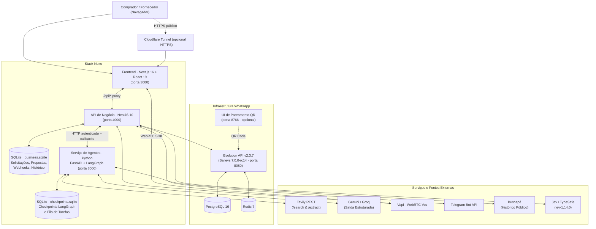

<p align="center">
  <a href="https://hub.digitaly.tech/hackathon-03/">
    
  </a>
</p>

<p align="center">
  🏆 <b>Equipe campeã</b> da <a href="https://hub.digitaly.tech/hackathon-03/">Guerra das IAs · Hackathon Digitaly 03</a><br>
  07 e 08 de novembro de 2026 · Digitaly HUB, São Carlos
</p>

# Nexo · Procurement Intelligence

O **Nexo** é uma plataforma de inteligência de compras (procurement) que automatiza a pesquisa de mercado em lojas reais, verifica reputação de vendedores, negocia ativamente com fornecedores por voz e texto, analisa o histórico temporal de preços e apoia a decisão do comprador com recomendações auditáveis — mantendo a **decisão final sempre humana**.

---

## Sumário

- [Como funciona (fluxo ponta a ponta)](#como-funciona-fluxo-ponta-a-ponta)
- [Arquitetura do sistema](#arquitetura-do-sistema)
- [O que foi construído e usado em cada parte](#o-que-foi-construído-e-usado-em-cada-parte)
- [Stack tecnológica e integrações](#stack-tecnológica-e-integrações)
- [Principais recursos e garantias](#principais-recursos-e-garantias)
- [Estrutura do repositório](#estrutura-do-repositório)
- [Como executar](#como-executar)
- [Testes e validação](#testes-e-validação)
- [Documentação técnica complementar](#documentação-técnica-complementar)

---

## Como funciona (fluxo ponta a ponta)

1. **Solicitação:** o comprador cadastra produto, especificações técnicas, quantidade e CEP de entrega no workspace.
2. **Pesquisa de mercado e reputação:** o serviço de agentes aciona **Tavily** (`/search` e `/extract`) para localizar ofertas reais, extrair preços com fontes verificáveis e consultar a reputação das lojas no **Reclame Aqui** (nota, selo RA1000 e evidências). Os resultados alimentam a comparação mesmo se chegarem após o encerramento da negociação direta.
3. **Contato multicanal com fallback automático:**
   - **1º — Voz (Vapi / WebRTC):** a aplicação envia ao fornecedor um convite com link assinado (`/call/[id]`) para chamada full-duplex no navegador.
   - **2º — WhatsApp (Evolution API):** sem atendimento de voz em **2 minutos** (`VOICE_ANSWER_TIMEOUT_SECONDS=120`), o sistema inicia a cotação por texto no WhatsApp.
   - **3º — Telegram:** após mais **1 minuto** sem resposta (`WHATSAPP_TELEGRAM_FALLBACK_SECONDS=60`), o fallback aciona o bot do Telegram.
   - A primeira resposta aceita **fixa o canal vencedor** e cancela o fallback nos demais canais. Quando a chamada de voz é atendida, sua transcrição é enviada ao WhatsApp ao encerrar.
4. **Negociação estruturada:** o agente coleta preço unitário, frete, taxas adicionais, prazo de entrega, estoque e confirmação de produto/CEP. Por texto, uma máquina de estados determinística negocia contrapropostas respeitando recusas explícitas e permitindo até **3 rodadas de melhoria**. A confirmação do fornecedor conclui a cotação e move o card no Kanban.
5. **Análise econômica, timing de preços e recomendação:** no Dashboard (`/dashboard/analise-economica`), o comprador compara **Custo do fornecedor**, **Menor custo** e **Custo total final (TCO)**, consulta o histórico diário real de preços no **Buscapé** (30/60/90 dias) com o `PriceTimingAgent` e pode gerar uma recomendação assistida pelo **Jev / TypeSafe**.
6. **Decisão humana e simulação:** confirmar uma cotação ou aprovar uma recomendação **não dispara compra nem pagamento real**. A decisão permanece humana e o fluxo de simulação de compra é totalmente separado de qualquer cobrança.

---

## Arquitetura do sistema



---

## O que foi construído e usado em cada parte

### 1. Frontend (`frontend/`)
Interface web completa construída com **Next.js 16**, **React 19**, **TypeScript**, **Tailwind CSS 4**, **Recharts 3**, **Lucide React** e **`@vapi-ai/web`**.

- **Workspace e Kanban (`app/page.tsx`, `SideDrawer.tsx`, `RequestActions.tsx`):** painel operacional atualizado automaticamente a cada **2 segundos**, com gaveta lateral de detalhes, propostas, recomendação Jev no topo da área visível, chat ao vivo (`LiveChatModal.tsx`) e ações de **Excluir solicitação** e **Refazer compra**.
- **Dashboard e Análise Econômica (`app/dashboard/analise-economica/`):** cards comparativos (**Custo do fornecedor**, **Menor custo** e **Custo total final**) calculados em centavos (`BigInt`), gráficos comparativos em Recharts e seção de **Histórico Temporal e Timing de Compra** (`PriceTimingSection.tsx`) com seletor de produto candidato no Buscapé e janelas de **30 / 60 / 90 dias**.
- **Histórico Operacional (`app/history/` e `app/history/[id]/`):** listagem paginada (10, 20 ou 50 itens) com busca literal por produto, filtros por estágio e período sincronizados na URL, visualização de conversas separadas por canal/contato e linha do tempo factual.
- **Chamada de Voz WebRTC (`app/call/[id]/page.tsx`):** sala de chamada full-duplex no navegador para o fornecedor via `@vapi-ai/web`, autenticada por token de sessão assinado.
- **Autenticação e Configurações (`app/login/`, `app/register/`, `app/settings/`):** login local com JWT, suporte a **Google OAuth2** (com fallback local) e painel de configuração/status da integração de busca (Tavily).
- **Proxy interno (`app/api/[...path]/route.ts`):** encaminha chamadas do navegador para a API NestJS com validação de origem, sem expor credenciais internas ou serviços Python/Nest diretamente.

### 2. API de Negócio (`api/`)
Serviço central em **NestJS 10**, **TypeScript** e **SQLite (`better-sqlite3`)**, executando na porta `4000`.

- **Gestão de solicitações e propostas (`src/main.ts`):** ciclo de vida completo (`recebida` → `pesquisando` → `aguardando` → `comparação` → `decidida`), criação atômica de tarefas para os agentes, callbacks autenticados via `INTERNAL_API_TOKEN`, exclusão permanente em transação (`DELETE /requests/:id`) e repetição limpa de compra (`POST /requests/:id/repeat`).
- **Orquestração multicanal e WhatsApp (`src/whatsapp.ts`, `src/runtime-integrations.ts`):**
  - Controle de prioridade **WebRTC → WhatsApp → Telegram** com deadlines persistidos no SQLite (`whatsapp_contact_flow`), sobrevivendo a reinícios.
  - Inbox persistente e deduplicada (`whatsapp_updates`) com até 3 tentativas de interpretação e suporte a reprocessamento auditável (`POST /requests/:id/whatsapp/reprocess`).
  - Desambiguação por citação (`stanzaId`), suporte a JIDs `@s.whatsapp.net` e `@lid` (`remoteJidAlt`), e lock de canal vencedor.
  - Autoconfiguração de instância/webhook na Evolution e registro de webhook Telegram (com suporte a `ip_address` em caso de falha de DNS).
- **Negociação determinística por texto (`src/text-negotiation.ts`):** controla rodadas de contraproposta (até 3 rodadas), concessão progressiva em direção à oferta do fornecedor, detecção determinística de aceite inequívoco ou recusa definitiva, e resumo final de confirmação antes do registro da cotação.
- **Sessão de voz e reconciliação Vapi (`src/voice-session.ts`):** gera e valida tokens HMAC-SHA256 (`callSessionToken`) com expiração e conferência de `request_id`/`supplier_id`, além de reconciliar chamadas ativas na Vapi a cada **15 segundos** para recuperar relatórios terminais perdidos pelo navegador.
- **Recomendação de compra com Jev/TypeSafe (`src/purchase-recommendation.ts`):** integra com o modelo `jev-1.14.0` para avaliar equivalência de produto e suporte de evidências, mantendo cálculos financeiros estritamente em código (centavos) e aplicando a política de prêmio máximo do fornecedor (`SUPPLIER_MAX_PREMIUM_PERCENT=5%`) somente quando há TCO completo e prazo compatível.
- **Histórico operacional e simulação (`src/history.ts`, `src/purchase-delivery.ts`):** consultas paginadas somente leitura (`GET /history`, `GET /history/:id`) sem vazar dados internos ou números de telefone, e fluxo isolado de simulação de compra.

### 3. Serviço de Agentes (`backend/`)
Serviço de IA em **Python 3.11+**, **FastAPI**, **Uvicorn**, **LangGraph 1.x** e **Pydantic v2**, executando internamente na porta `8000`.

- **Orquestração LangGraph (`app/agent_service.py`):** fila persistente em SQLite (`agent_tasks`) + checkpoints LangGraph (`langgraph-checkpoint-sqlite`), executando os nós `research_node` → `prepare_node` → `parse_node` → `analysis_node` e enviando resultados via callbacks autenticados para a API NestJS.
- **Agentes estruturados (`app/agent_intelligence.py`):** utiliza saída estruturada (`extra='forbid'`) com **Gemini** (`langchain-google-genai`, padrão `gemini-3.8-flash`) ou **Groq** (`langchain-groq`, padrão `llama-3.3-70b-versatile`) nos papéis de:
  - *Discovery / TCO*: consolidação de ofertas elegíveis e cálculo de meta;
  - *Memória Comercial*: leitura factual de histórico de concessões;
  - *Negociador ("Roberto")*: redação natural em português com táticas (BATNA, desconto por volume, frete grátis, PIX);
  - *Auditor de Compliance*: revisão defensável de termos e métricas financeiras;
  - *Extrator de Cotação (`/interpret-quote`, `/conversation-turn`)*: extração estrita sem inventar termos ausentes nem converter taxas desconhecidas em zero.
- **Pesquisa real e reputação (`app/search_provider.py`, `app/scraper_tools.py`, `app/product_parsers.py`, `app/web_policy.py`):**
  - Integração REST direta com **Tavily** (`/search` e `/extract`) com reserva conservadora de créditos, limite de concorrência/URLs por tarefa, retentativa apenas em falha de conexão e respeito a cache/cooldown de saldo.
  - Consulta de reputação no **Reclame Aqui** (`POST /reputation-refresh`) com extração de nota, classificação (`RA1000`, etc.), período e hash de evidência, descartando perfis de loja física para ofertas online.
- **Histórico temporal de preços (`app/buscape_history.py`, `app/price_timing_agent.py`):**
  - Coleta candidatos e séries históricas reais da página pública do **Buscapé** (`__NEXT_DATA__`), validando domínio HTTPS, URL canônica, datas e valores em `Decimal`.
  - `PriceTimingAgent` isolado dos agentes de negociação, exigindo no mínimo 7 datas reais para calcular tendência, percentil e recomendação de timing — com fallback estatístico determinístico caso o LLM falhe, e estado explícito de indisponibilidade quando não há série (sem interpolação ou dados sintéticos).

### 4. Infraestrutura WhatsApp (`infrastructure/evolution/`)
- Container customizado `nexo-evolution:2.3.7-pairing-1` baseado em **Evolution API v2.3.7**, apoiado por **PostgreSQL 16** e **Redis 7** (exclusivos da Evolution; o banco de negócio permanece em SQLite).
- Inclui patch isolado em **`baileys@7.0.0-rc14`** (`patches/baileys+7.0.0-rc14.patch`) para corrigir pareamento (`companion_reg_refresh`), ACK pré-login e classificação de mensagens em tempo real (`offline="0"` → `notify`), validado no build por `verify-pairing.mjs` e `verify-receiving.mjs`.
- Serviço opcional **`whatsapp-pairing`** (`scripts/whatsapp_pair.py`) na porta `8766` para exibir o QR Code com rotação automática em `127.0.0.1` sem expor a chave da API ao navegador.

---

## Stack tecnológica e integrações

| Camada / Função | Tecnologias e Provedores | Papel no Nexo |
| --- | --- | --- |
| **Frontend** | Next.js 16, React 19, TypeScript, Tailwind CSS 4, Recharts 3, Lucide React | Workspace Kanban, Dashboard econômico, Histórico, Configurações, Auth |
| **API de Negócio** | NestJS 10, TypeScript, SQLite (`better-sqlite3`) | Persistência de negócio, webhooks, fallback multicanal, negociação, Auth JWT/Google |
| **Agentes de IA** | Python 3.11+, FastAPI, LangGraph 1.x, Pydantic v2, `langgraph-checkpoint-sqlite` | Orquestração de tarefas, pesquisa, extração estruturada, timing de preços |
| **LLMs** | Google Gemini (`gemini-3.8-flash`) / Groq (`llama-3.3-70b-versatile`) | Interpretação de cotações, negociação conversacional e análise estruturada |
| **Pesquisa & Reputação** | Tavily REST (`/search`, `/extract`), BeautifulSoup4, httpx, Reclame Aqui | Coleta de ofertas reais, extração de preços e verificação de reputação |
| **Voz Full-Duplex** | Vapi (`@vapi-ai/web`, WebRTC) | Chamada de voz no navegador (`/call/[id]`), transcrição e reconciliação de status |
| **Mensageria** | Evolution API v2.3.7 (Baileys, PostgreSQL 16, Redis 7), Telegram Bot API | Negociação via WhatsApp e fallback automático para Telegram |
| **Histórico de Preços** | Buscapé (dados públicos `__NEXT_DATA__`) + `PriceTimingAgent` | Série histórica real (30/60/90 dias) e análise de timing de compra |
| **Recomendação** | Jev / TypeSafe (`jev-1.14.0`) | Avaliação calibrada de equivalência e evidências para recomendação de compra |
| **Infraestrutura** | Docker / Podman Compose, Cloudflare Tunnel (`cloudflared`) | Orquestração de serviços, volumes persistentes e exposição HTTPS opcional |
| **Qualidade & Testes** | Pytest, Playwright, Node.js smoke suites | Testes unitários, integração, regressão de canais e E2E |

---

## Principais recursos e garantias

- **Integridade financeira:** cálculos em centavos inteiros (`BigInt` no frontend/API e `Decimal` no Python). Frete e taxas ausentes permanecem explicitamente desconhecidos — nunca são assumidos como zero.
- **Sem dados inventados:** se o Buscapé não retornar série histórica suficiente ou se a reputação no Reclame Aqui não for verificável, a interface informa a indisponibilidade com transparência.
- **Idempotência e resiliência:** webhooks deduplicados, `Idempotency-Key` em ações críticas, entregas com status `uncertain` ou `failed` registradas sem reenvio automático duplicado, e retomada de filas/deadlines após reinício dos containers.
- **Proteção contra prompt injection:** textos de páginas web, histórico e mensagens de fornecedores são tratados como dados não confiáveis; saídas dos LLMs usam esquemas Pydantic restritivos (`extra='forbid'`) sem permissão para sobrescrever números validados pelo backend.
- **Decisão humana preservada:** concluir uma cotação ou aprovar uma recomendação Jev apenas registra a decisão no workspace; nenhuma compra ou cobrança real é executada automaticamente.

---

## Estrutura do repositório

```text
.
├── api/                        # API de negócio NestJS + SQLite e suítes smoke
│   ├── src/                    # main.ts, whatsapp.ts, text-negotiation.ts, voice-session.ts,
│   │                           # purchase-recommendation.ts, history.ts, runtime-integrations.ts
│   └── scripts/                # Testes automatizados de integração e regressão (SQLite temporário)
├── backend/                    # Serviço de agentes Python (FastAPI + LangGraph)
│   ├── app/                    # agent_service.py, agent_intelligence.py, search_provider.py,
│   │                           # scraper_tools.py, buscape_history.py, price_timing_agent.py, etc.
│   ├── voice/                  # Configurações e esquema estruturado do agente de voz
│   └── tests/                  # Suíte Pytest (agentes, parsers, Buscapé, segurança, resiliência)
├── frontend/                   # Aplicação web Next.js 16 + React 19 + Tailwind CSS 4
│   ├── app/                    # Kanban, /dashboard/analise-economica, /history, /call/[id], /settings, Auth
│   ├── scripts/                # Teste de cálculo dos cards econômicos
│   └── tests/                  # Testes E2E Playwright
├── infrastructure/evolution/   # Dockerfile e patch Baileys 7.0.0-rc14 para Evolution API v2.3.7
├── scripts/                    # Utilitários locais (dev_nexo.py, whatsapp_pair.py, gateways e diagnóstico)
├── docs/                       # Documentação técnica detalhada por módulo e relatórios de validação
├── artifacts/final/            # Evidências sanitizadas de validação (gates e chamadas Jev)
├── compose.yaml                # Orquestração principal (api, agents, frontend, evolution, db, redis)
├── compose.public.yaml         # Override opcional com túnel HTTPS (cloudflared)
├── Makefile                    # Atalhos de instalação, testes, build e cobertura
└── .env.example                # Modelo completo de variáveis de ambiente
```

---

## Como executar

### Com Docker / Podman Compose (recomendado)

1. Crie o arquivo `.env` a partir do modelo:

```sh
cp .env.example .env
```

2. Preencha no `.env` as credenciais das integrações desejadas e os segredos internos (use valores distintos e não vazios para `INTERNAL_API_TOKEN`, `JWT_SECRET`, `WHATSAPP_API_KEY`, `WHATSAPP_WEBHOOK_SECRET`, `VOICE_WEBHOOK_SECRET` e `TELEGRAM_WEBHOOK_SECRET`).

3. Suba a stack principal:

```sh
docker compose up -d --build
```

Acesse **[http://localhost:3000](http://localhost:3000)**. As cotações, os checkpoints dos agentes e a sessão do WhatsApp são preservados em volumes Docker (`business-data`, `agent-data`, `evolution-instances`, `evolution-db`, `evolution-redis`).

#### Conectar o WhatsApp (QR Code)

```sh
docker compose --profile pairing up -d --build whatsapp-pairing
```

Abra **[http://127.0.0.1:8766](http://127.0.0.1:8766)** e escaneie o QR em **WhatsApp → Aparelhos conectados**. Após conectar, você pode parar apenas o visualizador com `docker compose --profile pairing stop whatsapp-pairing`.

#### Expor com HTTPS para chamadas WebRTC e webhooks Telegram

Chamadas em outros dispositivos e webhooks do Telegram exigem HTTPS. O projeto inclui um túnel temporário opcional com Cloudflare (`cloudflared`):

```sh
docker compose -f compose.yaml -f compose.public.yaml up -d --build
```

O endereço público aparece nos logs do serviço `tunnel` e é descoberto automaticamente pela API via `TUNNEL_METRICS_URL` para gerar os convites `/call/[id]` e configurar o webhook Telegram.

### Desenvolvimento local (sem Docker)

Com Python 3.11+ e Node.js 22+ instalados:

```sh
make install
cd api && npm ci && npm run build && cd ..
backend/.venv/bin/python scripts/dev_nexo.py
```

### Principais variáveis de ambiente

Consulte [`.env.example`](.env.example) para a lista completa e defaults. Resumo por grupo:

| Grupo | Variáveis principais |
| --- | --- |
| **Segurança interna & Auth** | `INTERNAL_API_TOKEN`, `JWT_SECRET`, `GOOGLE_CLIENT_ID`, `GOOGLE_CLIENT_SECRET`, `NEXT_PUBLIC_GOOGLE_CLIENT_ID` |
| **LLMs & Pesquisa** | `LLM_PROVIDER` (`gemini` ou `groq`), `GEMINI_API_KEY`, `GEMINI_MODEL`, `GROQ_API_KEY`, `GROQ_MODEL`, `TAVILY_API_KEY`, `TAVILY_EXTRACT_*`, `REPUTATION_REFRESH_*` |
| **Voz (Vapi / WebRTC)** | `PUBLIC_APP_URL`, `VAPI_API_KEY`, `VAPI_PUBLIC_KEY`, `NEXT_PUBLIC_VAPI_PUBLIC_KEY`, `VAPI_ASSISTANT_ID`, `NEXT_PUBLIC_VAPI_ASSISTANT_ID`, `VOICE_WEBHOOK_SECRET`, `VOICE_ANSWER_TIMEOUT_SECONDS` |
| **WhatsApp (Evolution)** | `WHATSAPP_API_URL`, `WHATSAPP_API_KEY`, `WHATSAPP_INSTANCE_NAME`, `WHATSAPP_SUPPLIER_NUMBER`, `WHATSAPP_WEBHOOK_SECRET`, `WHATSAPP_TELEGRAM_FALLBACK_SECONDS`, `EVOLUTION_DB_PASSWORD` |
| **Telegram** | `TELEGRAM_BOT_TOKEN`, `TELEGRAM_WEBHOOK_SECRET`, `TELEGRAM_ALLOWED_CHAT_IDS`, `TELEGRAM_WEBHOOK_URL` |
| **Recomendação (Jev)** | `TYPESAFE_API_KEY` (ou `JEV_API_KEY`), `TYPESAFE_MODEL`, `SUPPLIER_MAX_PREMIUM_PERCENT` |

---

## Testes e validação

As suítes automatizadas utilizam bancos SQLite temporários, fixtures locais e stubs HTTP — não enviam mensagens reais a fornecedores nem consomem cobranças externas.

### Backend (Python / Pytest)

```sh
cd backend
.venv/bin/python -m pytest
# Testes focados em Buscapé e PriceTimingAgent:
.venv/bin/python -m pytest tests/test_price_timing_agent.py tests/test_buscape_history.py -q
```

### API de Negócio (NestJS / Node 22)

```sh
cd api
npm run build
npm run test:whatsapp
npm run test:voice
npm run test:price-history
npm run test:purchase-recommendation
node scripts/history-smoke.mjs
node scripts/request-actions-smoke.mjs
node scripts/telegram-recovery.mjs
node scripts/smoke.mjs
```

### Frontend (Next.js / Playwright)

```sh
cd frontend
npm run typecheck
npm run build
node --experimental-strip-types scripts/economic-costs-test.mjs
npm run test:e2e:controlled
```

---

## Documentação técnica complementar

- [WhatsApp, Voz WebRTC e fallback Telegram](docs/whatsapp.md)
- [Dashboard econômico e histórico temporal (Buscapé + PriceTimingAgent)](docs/price-timing.md)
- [Histórico operacional de compras](docs/historico.md)
- [Ações de solicitações (excluir e refazer compra)](docs/acoes-solicitacoes.md)
- [Validação da recomendação de compra com Jev/TypeSafe](docs/jev-compra-validacao.md)
- [Revisão e evidências de Tavily, Reclame Aqui e Telegram](docs/revisao-tavily-telegram.md)
- [Correção de respostas por canal e disputa WhatsApp/Telegram](docs/correcao-respostas-canais.md)
- [Relatório de testes de botões e ciclo de vida](docs/testes-botoes.md)
- [Patch de compatibilidade de pareamento da Evolution API (Baileys)](infrastructure/evolution/README.md)
